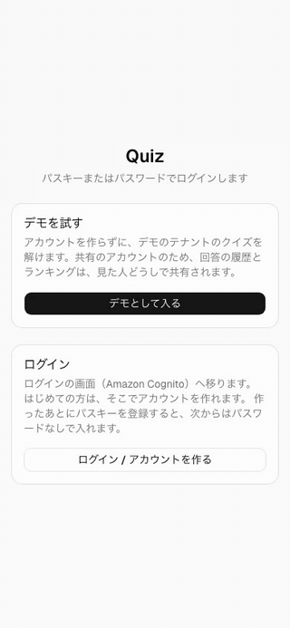
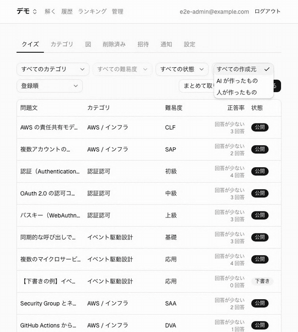
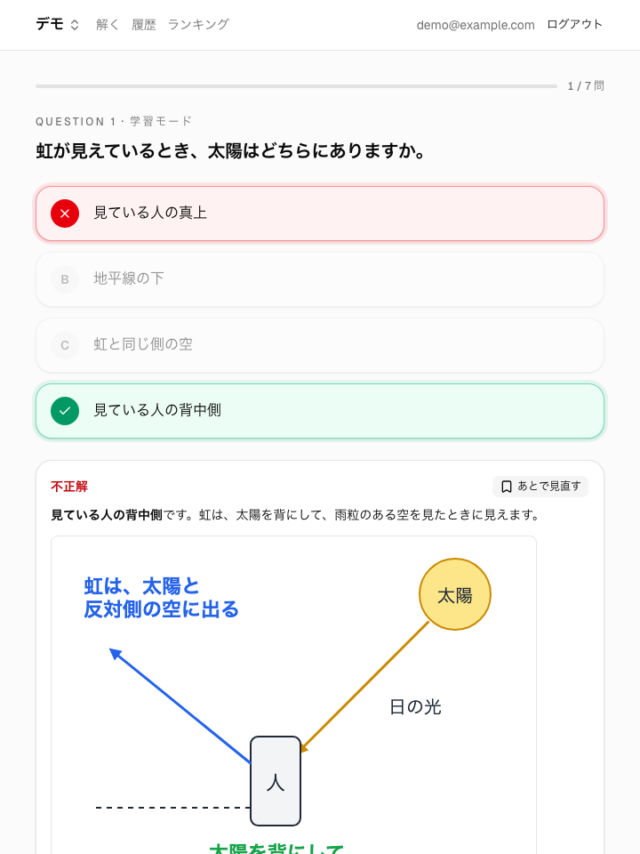
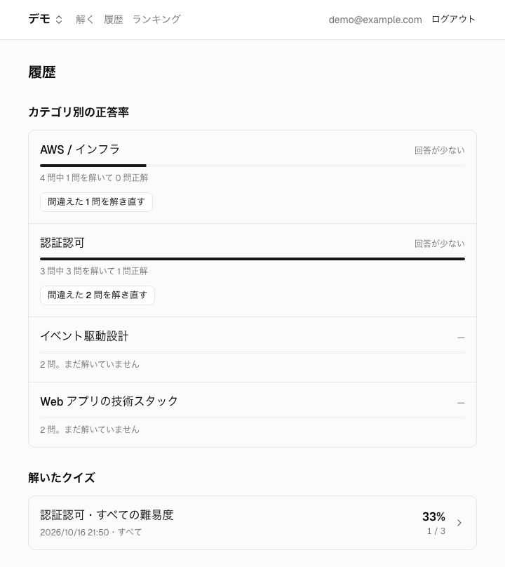
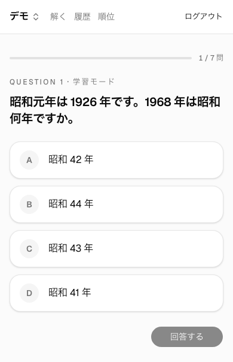
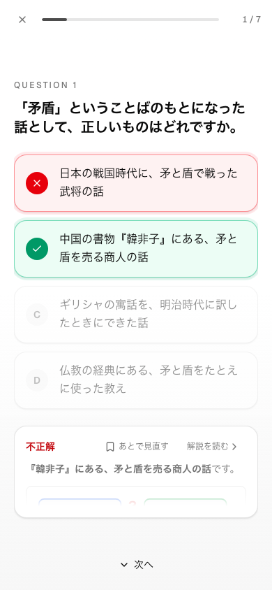
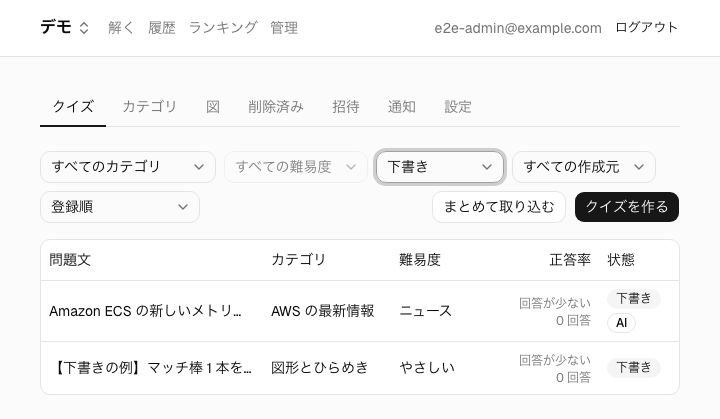
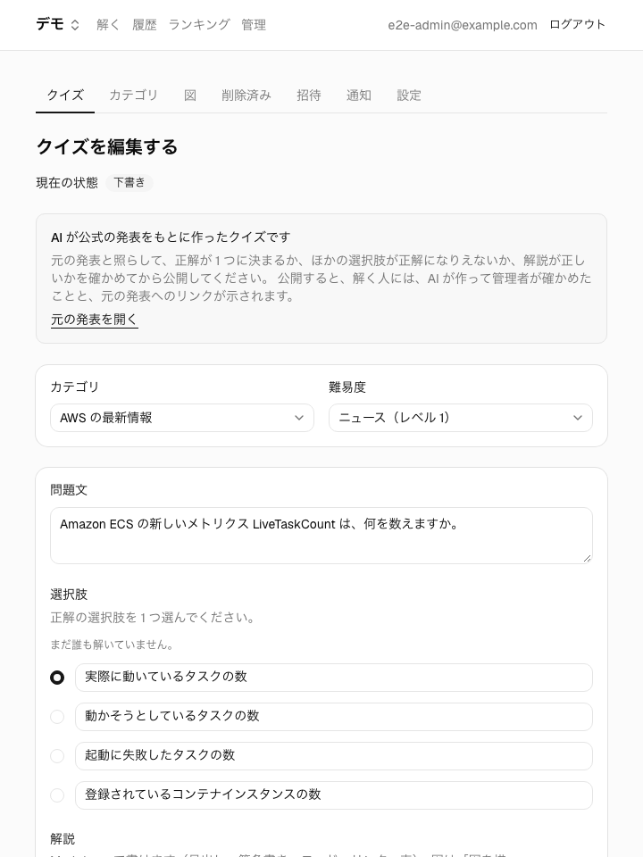

# quiz-app

カテゴリと難易度を自由に定義できる、マルチテナントのクイズアプリです。
管理者はそれぞれ独立したクイズ空間（テナント）を持ち、一般ユーザーは所属するテナントのクイズを解いて、正誤と解説、履歴、ランキングを見ます。
Web（Next.js）とモバイル（Expo）が同じ API（Kotlin / Spring Boot）を使い、AWS 上で動いています。

実装に加えて、設計判断の記録（ADR）、Terraform による IaC、GitHub Actions での CI/CD、監視と Runbook までを、このリポジトリで一貫して扱っています。

**デモ: https://quiz.portfolio-masayoshi.click** — トップの「デモとして入る」で、アカウントを作らずに試せます（[詳しく](#デモ)）

## 目次

- [できること](#できること) / [デモ](#デモ) / [画面](#画面)
- [設計の要点](#設計の要点) / [アーキテクチャ](#アーキテクチャ) / [技術スタック](#技術スタック) / [リポジトリの構成](#リポジトリの構成)
- [手元で動かす](#手元で動かす) / [ドキュメント](#ドキュメント) / [進め方](#進め方)

## できること

**解く人**

- カテゴリと難易度を選んで解き、正誤と解説を見る。学習モード（1 問ごとに解説）、模試モード（正誤を伏せて解き、結果で全問の解説を見る）、テンポモード（縦にスワイプして解く）がある
- 回答の履歴、カテゴリごとの正答率、テナント内のランキングを見る。間違えた問題を解き直し、忘れたころに「今日の復習」で出し直す（[ADR-0033](docs/adr/0033-schedule-reviews-with-simplified-sm2.md)）
- 途中でやめたクイズを、別の端末からでも続きから解く
- 公開されたテナントを一覧から見つけて参加し、自分で退会する。退会すると、そのテナントでの履歴も消える（[ADR-0025](docs/adr/0025-let-signed-in-users-join-public-tenants.md)、[ADR-0030](docs/adr/0030-let-members-leave-tenant-and-erase-their-history.md)）

**管理する人**

- ログインした人は、自分が管理者のテナントを 1 つ作れる（[ADR-0028](docs/adr/0028-let-signed-in-users-create-their-own-tenant.md)）
- カテゴリ・難易度・クイズを作り、下書きと公開を切り替える。解説は Markdown で書き、draw.io の図・画像・PDF を入れられる
- 一般ユーザーと管理者を、リンクで招待する。受け入れるときに、招待したメールアドレスと一致するかを確かめる
- クイズの追加と更新を、テナントの Slack に知らせる
- 公式の技術ニュース（AWS の What's New）から AI（Amazon Bedrock）が毎日作る下書きを確かめ、直して公開する。公開するまで出題されない（[ADR-0031](docs/adr/0031-draft-quizzes-from-official-tech-news-with-bedrock.md)）

ログインにはパスキー（WebAuthn）とパスワードを使えます。
モバイルアプリでは、出題と回答、解説（図を含む）、履歴、続きから解くことに加え、管理者はクイズの作成と編集ができます（[ADR-0032](docs/adr/0032-build-mobile-app-with-expo-and-sign-in-through-system-browser.md)、[ADR-0037](docs/adr/0037-build-quiz-admin-screens-in-mobile-app.md)）。

## デモ

**https://quiz.portfolio-masayoshi.click** のトップで「**デモとして入る**」を押すと、共有のアカウントでデモのテナントに入れます。
カテゴリを選ばなくても、「おすすめの5問を始める」からすぐに解き始められます。ログインの画面（Amazon Cognito）から入るときは、次のアカウントを使ってください。

| メールアドレス | パスワード |
| --- | --- |
| `demo@example.com` | `GwXS1XfXEFlr6888` |

- デモのテナントには、お菓子・ブランド・映画などの身近な雑学 5 カテゴリと、地理・科学・歴史などの一般教養 11 カテゴリがあります。解説には出典と、オリジナルの図解を付けています
- 共有のアカウントなので、回答の履歴とランキング、今日の復習は、見た人同士で共有されます
- ヘッダの「管理」から、管理画面（クイズ、カテゴリ、図、削除済み、通知、設定）を見学できます。共有のアカウントは見るだけで、保存や削除はできません（[ADR-0035](docs/adr/0035-let-shared-demo-account-view-admin-screens-read-only.md)）
- 管理を試すときは、ログインの画面で自分のアカウントを作り、「自分のテナントを作る」から始めてください。テナントは 1 人 1 つで、クイズは 100 問、図は 50 個までです
- AI の下書きは開発環境（dev）だけで動かしています。確かめて公開するまでの流れは、下の「画面」にあります
- しばらく（15 分）使われていないと DB が一時停止しており、最初の読み込みに 20 秒ほどかかります。3 秒を過ぎると、待っている旨の案内が出ます

## 画面

| デモとして入り、解いて結果を見る（スマホの幅） | AI の下書きを確かめ、直して公開する（管理者） |
| --- | --- |
|  |  |

| 正誤と解説（学習モード） | 履歴とカテゴリ別の正答率 |
| --- | --- |
|  |  |

| 出題（スマホの幅） | テンポモード（縦にスワイプして解く） |
| --- | --- |
|  |  |

| 管理画面（クイズの一覧。AI が作ったものに印が付く） | AI が作った下書きの編集 |
| --- | --- |
|  |  |

画面は Playwright のスクリプトで撮っています（`pnpm --filter e2e capture`。[開発ガイドライン](docs/development-guidelines.md#readme-の画面)）。

## 設計の要点

- **テナントの境界を、DB でも守る。** テナント配下の全テーブルに PostgreSQL の行レベルセキュリティを付け、アプリが絞り込みを書き忘れても、DB が他のテナントの行を返さないようにしています。
  全エンドポイントを Spring から列挙し、別のテナントの ID では結果が返らないことを確かめるテスト（[`TenantBoundaryApiTest`](services/quiz-service/src/test/kotlin/com/quizapp/tenant/TenantBoundaryApiTest.kt)）があり、検証のないエンドポイントを足すと落ちます。
  行レベルセキュリティを付け忘れたテーブルは [`TenantIsolationTest`](services/quiz-service/src/test/kotlin/com/quizapp/tenant/TenantIsolationTest.kt) が見つけます（[ADR-0006](docs/adr/0006-row-level-multi-tenancy.md)）
- **API の型を、コードから画面までつなぐ。** OpenAPI の定義を Kotlin のコードから生成してリポジトリに固定し、定義から web とモバイルの API クライアント（TanStack Query のフックと Zod のスキーマ）を生成します。
  定義とずれた応答は、画面で壊れる前に Zod の検証で落ちます（[ADR-0010](docs/adr/0010-generate-openapi-from-code.md)）
- **トークンをブラウザに渡さない。** ログインは Cognito（Managed Login）に任せ、トークンは web のサーバーが暗号化した Cookie に持って API へ中継します。
  状態を変える要求は送り元のオリジンを確かめ、画面には CSP を付けます。OWASP Top 10 の観点での見直しは [セキュリティレビュー](docs/security-review.md) にあります（[ADR-0016](docs/adr/0016-authenticate-with-cognito-managed-login.md)）
- **利用者が上げたものを、そのまま配らない。** 解説図の SVG はアプリのオリジンから返さず、CloudFront が CSP（`sandbox`）を付けて署名付き URL で配ります。
  画像は中身で種類を確かめて読み直し、位置情報などのメタデータを落とします（[ADR-0017](docs/adr/0017-deliver-figures-with-cloudfront-signed-urls.md)、[ADR-0020](docs/adr/0020-reference-figures-from-explanations-and-add-images-and-pdfs.md)）
- **マージすれば、本番まで届く。** develop へのマージで dev に、main へのマージ（承認のあと）で prod に、同じワークフローで配ります。
  GitHub Actions は OIDC で AWS のロールを引き受け、アクセスキーを発行していません。動いているものと比べて変わったものだけを載せ、
  マイグレーションはサービスを入れ替える前に単発のタスクで流し、最後にスモークテストで web → API → DB のつながりを確かめます。
  PR では、ログインや招待、ロールによる出し分け、出題と管理の主な流れを Playwright の E2E テストで確かめます（[ADR-0015](docs/adr/0015-deploy-by-registering-task-definitions-from-ci.md)、[deploy.yml](.github/workflows/deploy.yml)）
- **使っていない時間の費用を、ほぼ 0 にする。** Aurora Serverless v2 は使われていないと一時停止し（min 0 ACU）、ロードバランサーと NAT Gateway は置かず、API の入口は API Gateway（HTTP API）にしています。
  止められない費用は月に数ドルです（[ADR-0013](docs/adr/0013-run-ecs-tasks-in-public-subnets.md)、[ADR-0019](docs/adr/0019-expose-api-through-api-gateway-http-api.md)、[コスト方針](docs/development-guidelines.md#8-コスト方針)）
- **止まっている DB を、要求の外で起こさない。** クイズの変更の通知は、変更と同じトランザクションで Outbox に書き、EventBridge 経由で Lambda が Slack に送ります。受け手は重複を捨てます（[ADR-0022](docs/adr/0022-publish-quiz-events-through-outbox-and-notify-slack-per-tenant.md)）。
  AI の下書きは、Lambda が Bedrock に「選ぶ → 書く → 確かめる」の 3 段で作らせて S3 に置き、quiz-service が使われたときに取り込みます。1 日 3 件までで、費用は月 1 ドルほどです（[ADR-0031](docs/adr/0031-draft-quizzes-from-official-tech-news-with-bedrock.md)）
- **判断の根拠を残す。** 技術選定と設計のトレードオフを、採らなかった案とともに ADR に残しています（[テーマ別の索引](docs/adr/README.md)）
- **異常に気づき、戻せる。** ログは JSON で出し、要求の ID・テナント・利用者で 1 本の要求を追えます。アプリの 5xx、タスクの停止、イベントの滞留はアラームがメールで知らせ、
  夜間の停止や Aurora の一時停止といったふつうの動きでは鳴らないようにしています。鳴ったときの手順は [Runbook](docs/runbook.md) にあります

## アーキテクチャ

C4 モデルの [システムコンテキスト図](docs/architecture/context.svg) と [コンテナ図](docs/architecture/container.svg) があります（原本は draw.io の `docs/architecture/*.drawio`）。
要点だけを 1 枚にすると、次のとおりです。

```mermaid
flowchart LR
  browser([ブラウザ])
  mobile([モバイルアプリ<br/>Expo])
  gha[GitHub Actions]
  slack([Slack])
  news([AWS What's New<br/>RSS])

  subgraph aws [AWS]
    cognito[Cognito<br/>Managed Login]
    amplify[Amplify Hosting<br/>Next.js]
    apigw[API Gateway<br/>HTTP API]
    ecs[ECS Fargate<br/>quiz-service]
    aurora[(Aurora Serverless v2<br/>PostgreSQL)]
    s3[(S3<br/>解説図)]
    cloudfront[CloudFront]
    eventbridge[EventBridge]
    lambda[Lambda<br/>notification-service]
    drafter[Lambda<br/>news-quiz-drafter]
    bedrock[Bedrock<br/>Claude Haiku 4.5]
    inbox[(S3<br/>下書きの受け箱)]
  end

  browser -- ログイン --> cognito
  mobile -- ログイン --> cognito
  browser --> amplify
  amplify -- アクセストークンを付けて中継 --> apigw
  mobile -- トークンを付けて直接呼ぶ --> apigw
  apigw -- VPC リンク --> ecs
  ecs -- IAM 認証 --> aurora
  ecs --> s3
  browser -- 署名付き URL --> cloudfront --> s3
  ecs -- Outbox --> eventbridge --> lambda --> slack
  drafter -- 毎日 --> news
  drafter --> bedrock
  drafter --> inbox
  ecs -- 使われたときに取り込む --> inbox
  gha -- OIDC --> ecs
  gha -- ビルドを起動 --> amplify
```



サービスの境界は DB のスキーマ（`core` / `quiz` / `answer`）で引き、スキーマをまたぐ外部キーは貼りません。
回答・採点・履歴を担う `answer` は、`quiz-service` の中のモジュールとして実装し、物理的には分けないと判断しました。
分けたときの費用と往復に、独立したデプロイとスケールが見合わないためです（[ADR-0004](docs/adr/0004-split-services-incrementally.md)、[ADR-0023](docs/adr/0023-keep-answer-as-module-in-quiz-service.md)）。

## 技術スタック

| 領域 | 技術 | 決めた記録 |
| --- | --- | --- |
| バックエンド | Kotlin 2.3 + Spring Boot 4.1 (Java 21)、Spring Data JDBC、Flyway | [ADR-0002](docs/adr/0002-use-kotlin-and-spring-boot.md)、[ADR-0008](docs/adr/0008-use-spring-boot-4.md)、[ADR-0009](docs/adr/0009-use-spring-data-jdbc.md) |
| フロントエンド | Next.js (App Router) + TypeScript + Tailwind CSS + shadcn/ui、TanStack Query、Zod | [ADR-0003](docs/adr/0003-use-nextjs-for-frontend.md) |
| モバイル | React Native (Expo)、Expo Router、TanStack Query、Zod。ログインはシステムのブラウザで Managed Login を開く | [ADR-0032](docs/adr/0032-build-mobile-app-with-expo-and-sign-in-through-system-browser.md) |
| DB | Aurora PostgreSQL Serverless v2 (min 0 ACU)。アプリとマイグレーションは IAM 認証で接続 | [ADR-0014](docs/adr/0014-connect-to-aurora-with-iam-auth.md) |
| 認証 | Amazon Cognito（Managed Login、パスキー + パスワード） | [ADR-0016](docs/adr/0016-authenticate-with-cognito-managed-login.md) |
| 実行基盤 | ECS Fargate + API Gateway（HTTP API）、Amplify Hosting（フロント） | [ADR-0012](docs/adr/0012-serve-frontend-on-amplify-hosting.md)、[ADR-0019](docs/adr/0019-expose-api-through-api-gateway-http-api.md) |
| ファイル | S3 + CloudFront（署名付き URL） | [ADR-0017](docs/adr/0017-deliver-figures-with-cloudfront-signed-urls.md) |
| 非同期 / 通知 | EventBridge + Lambda + Slack Webhook。Outbox から送り、受け手が重複を捨てる | [ADR-0022](docs/adr/0022-publish-quiz-events-through-outbox-and-notify-slack-per-tenant.md) |
| 生成 AI | Amazon Bedrock（Claude Haiku 4.5）を Lambda から呼び、EventBridge Scheduler で毎日起動 | [ADR-0031](docs/adr/0031-draft-quizzes-from-official-tech-news-with-bedrock.md) |
| IaC | Terraform | [ADR-0011](docs/adr/0011-terraform-state-and-environments.md) |
| CI/CD | GitHub Actions（OIDC） | [ADR-0015](docs/adr/0015-deploy-by-registering-task-definitions-from-ci.md) |
| 監視 | CloudWatch（構造化ログ、アラーム、ダッシュボード）、Micrometer + X-Ray | [ADR-0026](docs/adr/0026-trace-requests-with-micrometer-and-x-ray.md) |
| テスト | JUnit 5 + Testcontainers、Vitest、Playwright、Postman / Newman、k6 | |

## リポジトリの構成

```
.
├── apps/
│   ├── web/                     # Next.js フロントエンド
│   └── mobile/                  # Expo のモバイルアプリ
├── services/
│   ├── quiz-service/            # テナント・クイズ・出題・採点・履歴・招待の API
│   ├── notification-service/    # EventBridge から起動し Slack へ通知する Lambda
│   └── news-quiz-drafter/       # 技術ニュースから AI でクイズの下書きを作る Lambda
├── libs/
│   └── quiz-events/             # サービスと Lambda で共有するイベントの形
├── content/demo/                # デモのクイズのパック（図を含む）
├── tools/content/               # パックを API で流し込む CLI
├── infra/
│   ├── docker/                  # ローカルの PostgreSQL と LocalStack
│   └── terraform/
│       ├── bootstrap/           # tfstate を置く S3 バケット
│       ├── account/             # アカウントに 1 つだけ置くもの（予算、OIDC のプロバイダ）
│       ├── modules/             # 再利用するモジュール
│       └── envs/                # dev / prod の環境定義
├── tests/
│   ├── api/                     # API のスモークテスト（Postman / Newman）
│   ├── e2e/                     # 画面の E2E テスト（Playwright）
│   └── load/                    # 負荷試験（k6）
├── docs/                        # ADR、C4 図、OpenAPI 定義、Runbook など
└── .github/workflows/           # CI と配備のワークフロー
```

## 手元で動かす

### Docker で一式を起動する

**ログインには Amazon Cognito の User Pool が要ります**（ローカルでも同じ）。User Pool は Terraform（`infra/terraform/envs/dev`）で作り、その出力を `.env` に入れます。

```bash
cp .env.example .env          # AUTH_* を埋める（書き方は .env.example）
docker compose up
```

`http://localhost:3000` を開き、ログインの画面でアカウントを作ると、最初は「招待を受けていない」と表示されます。
「自分のテナントを作る」から、自分が管理者のテナントを作れます。
デモ用のテナントに管理者として入るには、シードのデモ管理者に自分のメールアドレスを割り当てます（[最初の管理者](docs/development-guidelines.md#最初の管理者)）。

| | 場所 |
| --- | --- |
| アプリ | `localhost:3000` |
| API 定義（Swagger UI） | `localhost:8080/swagger-ui.html` |
| PostgreSQL | `localhost:5432` |
| LocalStack | `localhost:4566` |

ポートがほかのアプリと重なるときは、`.env` で変えてください。

### アプリをホストで動かす

開発ツールのバージョンは [mise](https://mise.jdx.dev/) で固定しています（Java 21 / Node.js 22 / pnpm）。依存サービスだけをコンテナで起動します。

```bash
brew install mise
echo 'eval "$(mise activate zsh)"' >> ~/.zshrc   # 初回のみ
mise install                                     # .mise.toml のバージョンを導入
mise exec -- lefthook install                    # commit の前に secret を探すフックを入れる

docker compose up -d postgres localstack
set -a && source .env && set +a                  # ログインの設定（AUTH_*）を読み込む
SPRING_PROFILES_ACTIVE=dev,migrate ./gradlew :services:quiz-service:bootRun   # マイグレーションを流して終了する
SPRING_PROFILES_ACTIVE=dev ./gradlew :services:quiz-service:bootRun
pnpm install && pnpm --filter web dev
```

アプリは起動時にマイグレーションしません。`dev,migrate` で流すと、デモ用のカテゴリとクイズも投入されます。
モバイルアプリの動かし方を含め、詳しくは [開発ガイドライン](docs/development-guidelines.md#7-ローカル開発) を参照してください。

## ドキュメント

| 文書 | 中身 |
| --- | --- |
| [ADR](docs/adr/README.md) | 技術選定と設計判断。テーマ別の索引と、置き換えの関係 |
| [要件定義](docs/requirements.md) | ユースケース、画面一覧、URL 構成 |
| [ドメインモデル](docs/domain-model.md) / [DB スキーマ設計](docs/db-schema.md) | 何をデータとして持つか、テーブルと行レベルセキュリティ |
| [OpenAPI 定義](docs/api/openapi.yaml) | コードから生成した API の定義 |
| [開発ガイドライン](docs/development-guidelines.md) | 規約、ローカル開発、配備、コスト方針 |
| [Runbook](docs/runbook.md) | アラームが鳴ったときに見るものと戻し方 |
| [セキュリティレビュー](docs/security-review.md) | OWASP Top 10:2025 の観点での見直しと、残すリスク |
| [負荷試験](docs/load-test.md) | k6 の流し方と結果 |
| [ロードマップ](docs/ROADMAP.md) | 何をどの順番で作るか、なぜその順番か |

## 進め方

- **常にデプロイ可能な状態を保つ** — 機能を増やす前に CI/CD を通し、以降は「マージすれば動く」状態を維持する
- **判断の根拠を残す** — 技術選定とトレードオフは ADR に記録する
- **段階的にサービスを分割する** — ドメイン境界が固まるまでは単一サービスで実装し、DB スキーマとドメインイベントで境界のみ先に引く
- **コストを設計に織り込む** — Aurora Serverless v2 の min 0 ACU、NAT Gateway 不使用、イベント駆動による常駐リソースの削減

ローカルで動く MVP（Phase 1）から、AWS への配備、認証、イベント駆動、運用、公開（Phase 7）までを終え、prod を公開しています。
いまは Phase 8 として、同じ API を使うモバイルアプリを作っています（ストアには出していません）。
パスキーの自前実装は、設計を決めたうえで見送り、Cognito で動かしています（[ADR-0027](docs/adr/0027-design-self-hosted-passkeys-and-keep-cognito.md)）。
各段階の中身と順番の理由は [ロードマップ](docs/ROADMAP.md) にあります。
